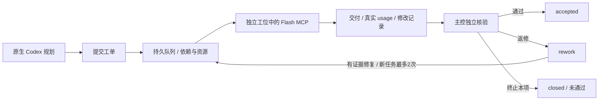

# Codex Agent Control

**A control panel for orchestrating external agents from native Codex.**

让原生 Codex 负责拆任务、指挥与独立验收，通过 MCP 调用外部执行者；在本地面板查看任务、真实 API 用量、工具活动与回收记录。

当前执行适配器是 **DeepSeek Flash**，通过 [deepseek-as-subagent](https://github.com/PsChina/deepseek-as-subagent)。控制台不会替换 Codex 主模型，也不会把外部执行者伪装成 Codex 原生子代理。其他提供商尚未实现。

- 最多 3 个隔离执行者；同一规范工作目录串行。
- SQLite 保存任务、执行批次、事件与逐请求 usage。
- 依赖通过后才运行；共享重型资源通过声明和预留串行。
- 执行结束进入 **待验收**；验收证据绑定任务、批次与文件 SHA256。
- 失败/中断保留成果，不自动重试或删除工位。
- 简洁的本地只读面板：当前任务、状态、进展和用时；历史记录与技术数据按需展开。
- 内置 `grill-me` 对齐技能；同一约定贯穿派工与验收，已明确的决定可复用。

这是实验性首版，已在 Windows / Python 3.12 上验证。主控决策、独立检查和最终集成仍由 Codex/操作者负责。

## 面板使用

- 默认显示近 24 小时更新的任务，以及所有排队、执行、待验收、返修和中断待回收任务；“显示历史”可查看其余记录。隐藏不等于删除。
- 搜索与状态筛选对当前显示范围生效；选择任务查看交付与审核证据，技术详情默认折叠。
- 活动记录、用量、资源占用和直接调用按需展开。交付、审核通过与回收未通过保持不同状态。
- “暂停刷新”只暂停页面轮询，不能停止执行者。离线时保留上次成功数据并明确标记。
- 前端不加载主题或角色装饰；旧皮肤资源与许可文件保留，浏览器中旧皮肤偏好不再应用。
- 参考 [bull-board](https://github.com/felixmosh/bull-board) 的任务列表与详情组织方式；未引入其代码、Redis 或其他运行依赖。

## 安装与启动

需要 Python **3.12**、Git，以及可用的 DeepSeek API。先阅读依赖代码；此项目不包含 API Key。

```powershell
git clone https://github.com/youdera/codex-agent-control.git
cd codex-agent-control
python -m venv .venv
.venv\Scripts\python.exe -m pip install -r requirements.txt
```

依赖固定到已验证的上游提交；此控制台包装上游的内部循环边界，上游升级后应重新验证。

在本机配置 `DEEPSEEK_API_KEY` 环境变量后，启动：

```powershell
.venv\Scripts\python.exe -I -X utf8 control_center.py serve
```

打开 [本地控制台](http://127.0.0.1:8791)。Windows 也可双击 `start-panel.cmd`。程序不创建系统启动项。

更新代码后，用正式生命周期命令加载新版：

```powershell
.venv\Scripts\python.exe -I -X utf8 service_control.py status
.venv\Scripts\python.exe -I -X utf8 service_control.py restart
```

Windows 也可双击 `restart-panel.cmd`。重启采用当前服务实例确认的正常退出协议，保留任务、用量和资源预留；存在排队或运行任务时会拒绝重启，不强杀执行者。API `service.code_hash` 标记实际加载的后端版本，`service.features` 标明已生效功能。缺少此协议的旧服务只报告需操作者核验后迁移，不自动终止进程。

Windows 可选地从已有的 Credential Manager 通用凭据 `codex-deepseek-mcp-api-key` 读取 Key；项目不会自动创建凭据。其他系统使用环境变量。不要把真实 Key 填进任务、命令参数、仓库或截图。

上游的非秘密配置位于用户目录下 `.deepseek-mcp/config.json`，模板见 [examples/mcp-config.example.json](examples/mcp-config.example.json)。若已使用上游 MCP，不要覆盖现有配置；确认 Flash 的调用名是 `deepseek-flash`。

可选环境配置（均无需写进源码）：

| 变量 | 默认值 | 用途 |
|---|---|---|
| `DS_CC_HOME` | 用户目录下 `.deepseek-mcp/control-center` | 私有运行数据目录，放在仓库外 |
| `DS_CC_PORT` | `8791` | 本地 HTTP 端口 |
| `DS_CC_MCP_PYTHON` | 当前 Python | 已安装上游依赖的解释器 |
| `DS_CC_MCP_LAUNCHER` | 本项目 `mcp_launcher.py` | MCP 启动器，可供已有安装接入 |

## 从派工到回收



### 1. 准备独立工位

只复制本任务需要的输入；原项目、源包、玩家数据保持由原 owner 管理。`workspace` 必须是已有的绝对项目目录。

**上游拒绝 `.codex`、`.agents`、`.deepseek-mcp` 等控制目录及其子目录。** 因此 Codex 管理的 `.codex/worktrees` 不能直接作为 DeepSeek 的 cwd；使用其他合法独立项目目录，不用路径别名或链接绕过保护。

执行者看不到主聊天或自动继承项目约定。主控必须在 `instruction/context` 中提供必要规则、已核来源、禁止操作和成功标准。

### 2. 提交有边界的完整任务

新任务先读 [有界派工与止损流程](WORKFLOW.md)，准备精确输入与执行计划。

先用内置 [grill-me](skills/grill-me/SKILL.md) 对齐目标、交付物、边界和验收标准。主控查事实、复用用户已有决定，只向用户追问关键未决项；执行者不重复盘问。面板“用量与技术信息”中的“派工前对齐提示词”按钮提供可复制内容，实际对齐在主控聊天完成。

新 CLI 工单必须附 `alignment` 摘要：`mode` (`grill-me` / `existing-contract`)、`goal`、`deliverables[]`、`acceptance[]`、`constraints[]`、`decisions[]`、`open_questions[]`、`basis`。未决问题非空时拒绝提交；程序检查结构，主控负责依据真实、确认不伪造。历史已登记任务兼容。

复制 [examples/work-order.example.json](examples/work-order.example.json)，填写合法工作目录后提交本地副本：

```powershell
.venv\Scripts\python.exe control_center.py prepare-order work-order.local.json prepared.local.json
.venv\Scripts\python.exe control_center.py submit prepared.local.json
```

- `id` / `idempotency_key` 防止重复提交；相同 key 配不同内容会被拒绝。
- `readonly: true` 只有 Read / Glob / Grep；需要运行命令或修改文件时使用 coding。
- `scope` 是相对工作目录的输入/输出清单，用于前后哈希核对；它不是 OS 沙箱。
- `dependencies` 中的任务必须 **accepted**，执行者自报完成不能放行。
- `resources` 声明共享资源；例如所有 UE/Blender/导入/渲染作业共同声明 `heavy-runtime`。
- 新任务默认最多2次执行；只读跨轮30000 token、修改跨轮60000 token，累计失败和返修。输入/输出/工具止损详见 WORKFLOW.md；旧工单历史不改。
- 本版工单 `coordinator` / CLI 审核者标签固定为“制作统筹”。这是本机工作流标签，不是身份认证。

```powershell
# 现有工具或部门正在占用重型资源时，由主控登记。
.venv\Scripts\python.exe control_center.py reserve heavy-runtime --owner 制作统筹

# 只有确认原 owner 已释放资源后才执行。
.venv\Scripts\python.exe control_center.py release heavy-runtime --owner 制作统筹
```

资源队列只约束登记任务，不能阻止外部进程、IDE 或用户手工改文件。上游 Bash 是 trusted-host execution，不是操作系统级沙箱。主控必须保持实际目录和设备的 owner 协调。

### 3. 看执行与交付

```powershell
.venv\Scripts\python.exe control_center.py status
.venv\Scripts\python.exe control_center.py cancel TASK_ID
```

服务启动每个执行者的独立 MCP 进程，cwd 绑定工位。工具名称、必要文件路径、起止事件和 API 返回的输入/输出/缓存用量持久化；面板不显示任务正文、命令全文、模型输出或 Key。

交付保存在运行目录的 `deliveries/TASK_ID/attempt-N.json`，包含最终结果、前后文件哈希及上游 recovery 记录。它是私有运行数据，不应提交 Git。

### 4. 先核修改恢复记录

修改、取消、断线后，先查看实际文件与日志。上游 Write/Edit/NotebookEdit 有事务记录；**Bash 改动没有事务日志**，必须独立核工作目录。

填入 [examples/recovery-review.example.json](examples/recovery-review.example.json)，包含当前任务/批次、精确 pending transaction IDs 和每个报告文件当前 SHA256：

```powershell
.venv\Scripts\python.exe control_center.py ack-recovery TASK_ID recovery-review.local.json
```

CLI 会重新查询上游当前记录，要求 ID 集合完全一致、文件哈希一致，确认后才清除本地 pending 状态。不要直接修改数据库或调用内部 Ledger 方法跳过此流程。

### 5. 独立验收、返修或关闭

填入 [examples/review.example.json](examples/review.example.json)：当前 `task_id`、`attempt`、`decision`、审核者、实际 checks，以及产物和交付 JSON 的绝对路径/SHA256。文件变化或批次不符会拒绝验收。

```powershell
.venv\Scripts\python.exe control_center.py review TASK_ID accepted review.local.json

# 有问题：同一逻辑任务返修，保留旧执行批次和成果。
.venv\Scripts\python.exe control_center.py review TASK_ID rework review.local.json
.venv\Scripts\python.exe control_center.py requeue TASK_ID "已验证的改变" --repair repair.local.json

# 不再继续：回收工位但不标通过，也不放行依赖。
.venv\Scripts\python.exe control_center.py review TASK_ID closed review.local.json
```

`decision` 要与命令一致。源码、编译、headless、实际画面/输入/声音等证据分别记录；缺证不冒称通过。控制台验证文件与流程，不代替内容质量判断。

## 中断与用量口径

- 服务重启保留队列、历史批次和 usage；仍存活的 runner 继续原任务。
- runner 失联会标 `interrupted`，保留文件和 coding 工位，由主控检查后决定回收；不自动重派。
- 逐请求 API usage 是 delta；缓存命中是输入的一部分，不能再加进总量。
- 不把最终累计汇总再次写入逐请求用量。模型返回 ID / 本轮请求标识用于去重。
- 没有收到响应 usage 的请求，无法精确核账；本版不估算金额，平台账单为准。
- 预算在操作边界检查，在途请求可能超出阈值；它不是硬性金额封顶。
- 只记录接入后的新 MCP 进程，旧调用不追溯。直接 MCP 诊断可显示用量，但没有登记工单时不冒称生产任务。

## 旧皮肤资源

`skins/<id>/skin.json` 和对应图片作为历史资源保留，当前前端不加载这些配置，也不提供皮肤切换。浏览器中已有的旧选择不会影响新界面。

后端旧资源接口保持兼容；本次界面改版不删除资源或更改其许可。

代码采用 MIT；保留的初音相关装饰是 AI 生成的非官方同人视觉，**不包含在代码 MIT 授权中**，角色相关权利归其权利人。详见 [ASSETS.md](ASSETS.md)。

## 验证与目录

```powershell
.venv\Scripts\python.exe -I -X utf8 -m unittest discover -p 'test*.py' -v
```

33 项检查覆盖任务对齐门、并发互斥、依赖验收门、修改恢复门、旧证据/旧批次拒绝、人工有界返修、外部资源预留、失联留档、关闭不放行依赖、逐请求去重、缓存口径，以及有工单时拒绝重启、旧服务不自动终止、防止重复启动，以及小预算的请求预留与总额耗尽拒绝，以及排队取消与调度互斥，以及真实子进程的 Python 解释器路径。

本机还实际核验过两名 Flash 并行、Edit + 真命令校验、只读随机标记、恢复确认、真实 runner 中断及桌面/手机界面。私有测试工单、运行日志和截图不随仓库发布；这不代表任意项目或上游新版本都已验证。

| 文件 | 职责 |
|---|---|
| `control_center.py` | CLI、队列、MCP runner、只读 HTTP |
| `ledger.py` | 持久任务/批次、资源、证据门 |
| `telemetry.py` | 最小化工具事件与真实 usage |
| `mcp_launcher.py` | 本地取 Key、安装监控包装、启动上游 |
| `settings.py` | 无秘密的路径/端口配置 |
| `service_control.py` | 显式启动、正常退出、重启及版本确认 |
| `alignment.py` / `skills/grill-me/` | 对齐摘要校验与主控访谈约定 |
| `index.html` / `skins/` | 面板与换肤 |

设计参考 [AgentMeter](https://github.com/LyleMi/AgentMeter)、[Vibe Kanban](https://github.com/BloopAI/vibe-kanban)、[Agent Orchestrator](https://github.com/OrchestratorInc/agent-orchestrator) 与 [GasTown](https://github.com/gastownhall/gastown)。这些框架没有被整套安装或嵌入。项目与 OpenAI、DeepSeek、角色权利人均无官方关联。

小预算任务的单请求最大输出上限为 `min(原配置, 16384, max(256, 总预算 // 4))`，为输入、多轮工具和最终回复留出空间；累计预算保护保持。`cancel <task-id>` 也支持排队工单，以原子状态更新阻止后续派发；不会标记通过或放行依赖。

执行工具的 PATH 优先使用配置解释器所在目录，避免 Windows 的 `python` 占位程序导致错误的退出码 9009。

实时状态按任务号和执行轮次绑定：新轮次启动前不显示旧轮的失败活动、交付或验收状态。上轮交付与审核在详情中明确标为历史，总用量仍保留所有轮次。

验收回执同样绑定轮次；已交付的新轮次也不会带出旧轮审核。旧格式回执仅在小于64KiB且哈希一致时解析所属轮次。

新增工作流检查覆盖确定性证据包、输入哈希与大小预检、父进程工具止损、跨轮额度、结构化修复、无变化重试拒绝及逐项验收。所有测试使用本地模拟工具与记录，不重放生产模型调用。
